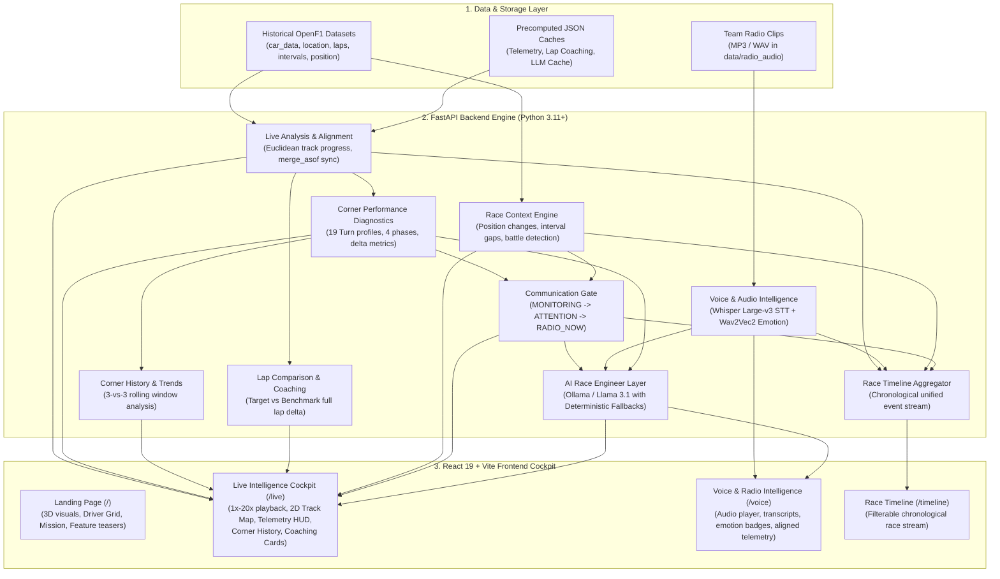
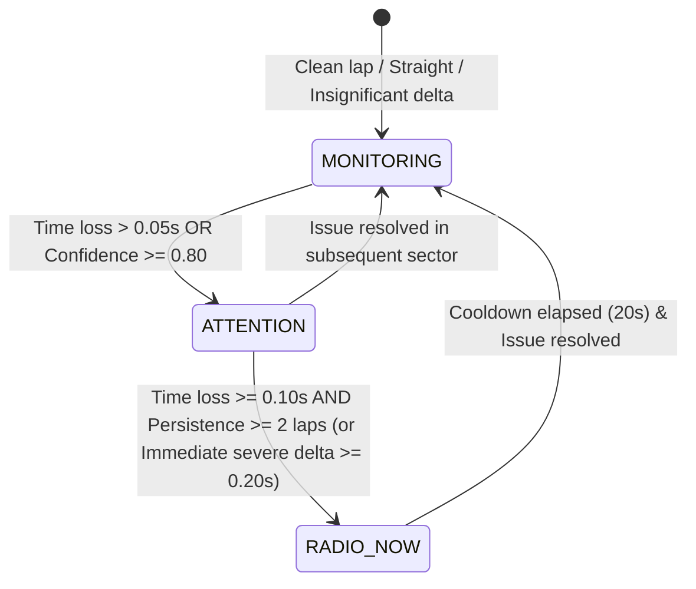
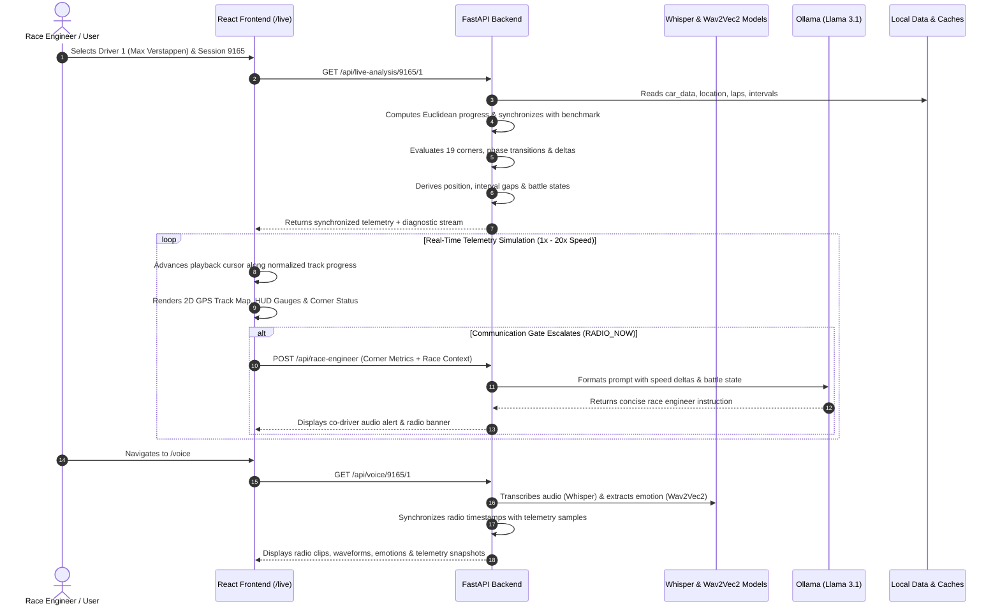

# Project Architecture, Workflow & Technical Guide: The Silent Co-Driver

> **The Silent Co-Driver** is an AI-powered Formula 1 race engineering platform built for offline and simulated live playback. It ingests historical telemetry, timing, and team radio audio (calibrated on the 2023 Singapore Grand Prix), runs deterministic kinematic analysis and vocal emotion models, and uses local LLM reasoning to deliver actionable, non-intrusive co-driver instructions.

---

## 1. Executive Summary & Vision

In Formula 1, race engineers have access to gigabytes of live telemetry per second, but drivers operate under extreme cognitive and physical load. Over-communicating causes critical distractions, while late communication loses lap time.

**The Silent Co-Driver** solves this with an **evidence-first, gated co-driver architecture**:
- **Continuous Background Monitoring:** Calculates entry speeds, apex minimums, exit speeds, braking points, and throttle application for every corner on every lap.
- **Dynamic Context Awareness:** Tracks real-time gaps, battles, defending status, and position changes.
- **Communication Gating:** Holds minor deltas in `MONITORING` or `ATTENTION` states, escalating to `RADIO_NOW` only when deltas persist, exceed severity thresholds, or represent significant time loss.
- **Multi-Modal Voice & Emotion Intelligence:** Transcribes driver team radio via Whisper, analyzes vocal emotion using Wav2Vec2, aligns audio to the exact telemetry sample on track, and formulates context-aware engineer advice via a local LLM (Ollama / Llama 3.1).

---

## 2. System Architecture & High-Level Design



---

## 3. Technology Stack & Dependencies

### Frontend (`f1-frontend`)
| Technology / Library | Version | Purpose |
|---|---|---|
| **React** | `19.2.8` | Component lifecycle, state management, and view layer |
| **Vite** | `8.2.0` | Ultra-fast build tool, HMR, and backend API proxy |
| **TypeScript** | `~6.0.2` | End-to-end type safety for API contracts and telemetry structures |
| **Tailwind CSS** | `4.3.3` | Custom F1 dark-mode design system with `@tailwindcss/vite` |
| **GSAP (GreenSock)** | `3.15.0` | High-performance hero animations and scroll triggers |
| **Motion (Framer Motion)** | `13.1.0` | Micro-interactions, telemetry HUD transitions, and card flips |
| **Three.js & OGL** | `0.185.1` / `1.0.11` | WebGL canvas shaders, track visualization, and 3D car styling |
| **React Router DOM** | `7.18.2` | Single-page client routing (`/`, `/live`, `/voice`, `/timeline`, `/history`) |
| **Lucide React** | `1.31.0` | Minimalist telemetry and navigation icons |

### Backend (`backend`)
| Technology / Library | Purpose |
|---|---|
| **FastAPI** | High-performance async REST API framework |
| **Uvicorn** | ASGI server for running the FastAPI application |
| **Pandas & NumPy** | Telemetry ingestion, timestamp alignment, trajectory interpolation (`merge_asof`), and Euclidean distance computation |
| **PyTorch & Transformers** | Local execution of Hugging Face Speech-to-Text & Emotion Recognition models |
| **`openai/whisper-large-v3`** | Local zero-shot speech-to-text transcription of noisy team radio audio |
| **`superb/wav2vec2-base-superb-er`** | Speech emotion classification (`neu`, `hap`, `ang`, `sad`) |
| **Librosa & Soundfile** | Audio resampling (16kHz), waveform normalization, and audio format processing |
| **Ollama (`llama3.1:latest`)** | Local LLM inference producing concise, F1-style engineer advice |

---

## 4. Core Subsystems & How They Work

### 4.1. Telemetry Alignment & Progress Normalization
* **File:** `backend/services/live_analysis.py`
* **How it works:**
  1. Car telemetry (`speed`, `throttle`, `brake`, `n_gear`, `rpm`, `drs`) is merged with GPS coordinate data (`x`, `y`).
  2. Each GPS sample is converted into a normalized progress coordinate $p \in [0.0, 1.0]$ by computing cumulative Euclidean distance along the track spline:
     $$\text{dist}_i = \sqrt{(x_i - x_{i-1})^2 + (y_i - y_{i-1})^2}, \quad \text{progress}_k = \frac{\sum_{i=1}^k \text{dist}_i}{\sum_{i=1}^N \text{dist}_i}$$
  3. The system dynamically locates the **Fastest Comparable Lap** (benchmark driver) from the same session and synchronizes the target driver's data points using `pandas.merge_asof()` on normalized progress.

---

### 4.2. Corner Performance Diagnostics & Geometry
* **File:** `backend/data/singapore_2023_track.py`, `backend/services/live_analysis.py`
* **Singapore Track Model:** Configured with progress intervals for 19 corners (`T1` through `T19`).
* **Corner Phases:** For every sample within a corner's boundary, one of four phases is resolved:
  - `APPROACH`: Heading into the braking zone.
  - `BRAKING`: Brake pressure $> 0$ prior to the apex.
  - `CORNER`: Low speed / transition around the apex.
  - `EXIT`: Progressive throttle application past the apex.
* **Deterministic Diagnostic Rules:**
  - **`EARLY_BRAKING`**: Target brakes $> 0.005$ progress units earlier than benchmark and entry speed is $> 5\text{ km/h}$ lower.
  - **`LOW_ENTRY_SPEED`**: Entry speed is $> 10\text{ km/h}$ lower than benchmark.
  - **`LOW_MIN_SPEED`**: Apex minimum speed is $> 7\text{ km/h}$ lower than benchmark.
  - **`LATE_THROTTLE`**: Full throttle application occurs $> 0.005$ progress units later than benchmark.
  - **`LOW_EXIT_SPEED`**: Exit speed is $> 8\text{ km/h}$ lower than benchmark.
  - **`GOOD`**: Driver matches or exceeds the benchmark within tolerance thresholds.

---

### 4.3. Multi-Lap Corner History & 3-vs-3 Rolling Trends
* **File:** `backend/services/corner_history.py`
* **How it works:**
  - Groups historical samples across laps for a specific corner.
  - Computes entry speed, brake initiation progress, apex minimum speed, exit speed, and time loss for each lap.
  - When $\ge 6$ laps of data are collected, it runs a **3-vs-3 Rolling Window Comparison** (averaging the most recent 3 laps against the preceding 3 laps).
  - Automatically identifies performance trends: `IMPROVING`, `DEGRADING`, or `STABLE`.

---

### 4.4. Completed Lap Benchmark Coaching
* **File:** `backend/services/lap_comparison.py`
* **How it works:**
  - Performs lap-by-lap delta breakdowns between target and benchmark cars upon lap completion.
  - Identifies top time-loss corners (e.g. losing $+0.24\text{s}$ at Turn 7 due to early braking).
  - Feeds telemetry deltas to the LLM to generate structured lap-end engineering debriefs.

---

### 4.5. Race Context & Battle Detection
* **File:** `backend/services/race_context.py`, `backend/services/voice_context.py`
* **How it works:**
  - **Position Tracking:** Resolves current position, driver ahead, driver behind, and gap times.
  - **Battle Detection:** If the gap to the car behind remains $< 0.25\text{s}$ over at least 2 consecutive observations with data age $< 15.0\text{s}$, `battle_active` is flagged as `true`.
  - **Defending State:** Sets `is_defending = true`, prompting the race engineer to prioritize defensive line management and exit traction over aggressive entry speeds.
  - **Position Change Triggers:** Flags `POSITION_GAIN`, `POSITION_LOSS`, `MULTI_POSITION_GAIN`, or `MULTI_POSITION_LOSS`.

---

### 4.6. Communication Gate & Alert Escalation
* **File:** `backend/services/live_analysis.py`
* **How it works:**
  Prevents cognitive overload by controlling when information reaches the driver via three distinct tiers:



- **Thresholds:**
  - Minimum Radio Confidence: `0.80`
  - Time Loss Threshold: `0.10s`
  - High Severity Escalation: $\ge 0.20\text{s}$ (triggers immediate escalation)
  - Radio Cooldown Period: `20s` (suppresses non-urgent duplicate callouts)

---

### 4.7. Voice & Team Radio Intelligence (Whisper + Wav2Vec2)
* **File:** `backend/services/voice.py`, `backend/services/voice_identity.py`
* **How it works:**
  1. Filters `team_radio.csv` by session and driver, downloading corresponding MP3/WAV recordings.
  2. Runs **Whisper Large-v3** locally for speech transcription.
  3. Feeds raw 16kHz audio into **Wav2Vec2 Emotion Recognition** (`superb/wav2vec2-base-superb-er`), yielding probabilities for `neutral`, `happy`, `angry`, and `sad`.
  4. Derives `voice_state`:
     - `CALM`: High neutral probability ($\ge 0.70$).
     - `ELEVATED`: Moderate non-neutral shifts.
     - `HIGH_INTENSITY`: Low neutral probability combined with high anger/urgency signals.
  5. **Telemetry Alignment:** Finds the telemetry sample recorded at the radio transmission timestamp (within a 5-second tolerance window), binding the audio to the car's speed, gear, throttle, corner position, and race battle state.

---

### 4.8. AI Race Engineer Advice Generation (Ollama / Fallback)
* **File:** `backend/services/race_engineer.py`
* **How it works:**
  - Translates structured telemetry deltas and race context into a concise prompt for `llama3.1:latest` running via Ollama (`http://localhost:11434/api/chat`).
  - System prompt restricts output to authentic F1 radio phrasing (e.g., *"Focus on Turn 7 entry, carry 8 km/h more minimum speed, Russell is 0.4s behind"*).
  - **Deterministic Fallback:** If Ollama is offline or times out, the backend instantly generates deterministic advice strings based on the detected diagnostic enum to prevent UI interruption.

---

## 5. End-to-End Operational Workflow



---

## 6. Frontend Pages & Interactive Modules

### 1. Landing Page (`/`)
* **Hero Section:** High-impact typography with GSAP entrance animations, dynamic F1 background visual, and quick-launch action triggers.
* **Mission Strip & Features:** Interactive breakdown of real-time monitoring, telemetry delta calculation, and gated AI communications.
* **Driver Wall (`Drivers.tsx`):** Real-time grid roster populated via `/api/grid`.
* **Teaser Modules:** Previews for live telemetry replaying and radio intelligence.

### 2. Live Intelligence Cockpit (`/live`)
* **Playback Controller:** Variable playback rate (`1x`, `2x`, `5x`, `10x`, `20x`), play/pause toggle, and timeline scrubbing slider.
* **2D GPS Track Map:** Real-time track rendering with car position markers and corner sector overlays.
* **Live Telemetry HUD:** Speed, RPM, Throttle, Brake, Gear indicator, and DRS status gauges.
* **Corner Delta & Phase Card:** Displays current corner name (`T1`-`T19`), active phase (`APPROACH`, `BRAKING`, `CORNER`, `EXIT`), entry/min/exit deltas, and diagnostic badge.
* **Corner History Panel (`CornerHistoryPanel.tsx`):** 3-vs-3 rolling trend visualizations and multi-lap performance history.
* **Lap Coaching Panel (`LapCoachingPanel.tsx`):** Completed lap telemetry comparisons against benchmark drivers.
* **Race Context HUD:** Live position badge, driver behind indicator, battle alert pulse, and defending status.
* **Communication Gate Banner:** Visual status badges (`MONITORING`, `ATTENTION`, `RADIO NOW`) with real-time engineer callouts.

### 3. Voice & Radio Intelligence (`/voice`)
* **Radio Message Stream:** Chronological feed of recorded team radio transmissions.
* **Audio Waveform & Player:** In-browser audio playback of downloaded team radio clips.
* **Whisper Transcription Card:** Speech-to-text transcript output.
* **Wav2Vec2 Vocal Emotion Breakdown:** Percentage bars for `neutral`, `happy`, `angry`, and `sad` with derived `voice_state` badge (`CALM`, `ELEVATED`, `HIGH_INTENSITY`).
* **Aligned Telemetry Snapshot:** Car speed, gear, throttle, brake, corner, and battle context captured at the exact moment the driver pressed the radio button.
* **AI Engineer Co-Driver Brief:** LLM-generated tactical interpretation of the driver's radio message.

### 4. Tyre Degradation Intelligence (`/tyres`)
* **Compound DNA Empirical Fingerprints (`CompoundDNAStrip.tsx`):** Linear wear slopes (`s/lap`), peak wear deltas, base pace estimates, and sparkline fingerprints for each compound.
* **Causal Degradation Curve (`TyreDegradationCurve.tsx`):** Interactive D3/SVG wear curve with Bayesian 90% credible interval envelope, cliff threshold overlay, and hover causal decomposition drawer.
* **Counterfactual Lap Cards (`CounterfactualCardsSection.tsx`):** Showcase and representative lap cards displaying the exact time lost to degradation versus fresh tyre delta.
* **Holdout Validation Scorecard (`ValidationScorecardSection.tsx`):** Mid-stint holdout validation metrics (MAE, RMSE, Pearson r, accuracy score) verifying prediction fidelity on unseen laps.
* **Monte Carlo Strategy Simulator (`StrategySimulatorSection.tsx`):** Interactive lap decision slider simulating Conservative, Nominal, and Aggressive pit strategy outcomes with uncertainty bounds.

### 5. Race Timeline (`/timeline`)
* **Chronological Event Aggregator:** Merges telemetry anomalies, radio transmissions, battle alerts, and tyre intelligence events (`PIT_WINDOW_OPENED`, `TYRE_CLIFF_ONSET`, `TYRE_ALERT_ESCALATION`).
* **Interactive Navigation:** Direct links to inspect specific events inside `/live`, `/voice`, or `/tyres`.

### 6. Historical Context (`/history`)
* Dedicated context view embedding historical Grand Prix background and race reports.

---

## 7. API Reference Specification

Base URL: `http://localhost:8000`

| Endpoint | Method | Params / Payload | Description |
|---|---|---|---|
| `/api/grid` | `GET` | None | Returns the active driver grid and team metadata. |
| `/api/replay/{session_key}/{driver_number}` | `GET` | `session_key` (int), `driver_number` (int), `lap` (query, default 2) | Returns raw telemetry and GPS coordinates for track replay. |
| `/api/live-analysis/{session_key}/{driver_number}` | `GET` | `session_key` (int), `driver_number` (int) | Main stream: normalized progress, benchmark deltas, corner diagnostics, race context, and gate states. |
| `/api/voice/{session_key}/{driver_number}` | `GET` | `session_key` (int), `driver_number` (int) | Returns audio URLs, Whisper transcripts, Wav2Vec2 emotions, aligned telemetry, voice tyre alignment, and AI advice. |
| `/api/tyre/{session_key}/{driver_number}` | `GET` | `session_key` (int), `driver_number` (int) | Full per-lap tyre intelligence feed: quality flags, causal decomposition, Kalman state estimation, and cliff risk. |
| `/api/tyre/counterfactual/{session_key}/{driver_number}` | `GET` | `session_key` (int), `driver_number` (int) | Showcase counterfactual cards and component breakdowns (fuel, track evolution, base pace, tyre wear). |
| `/api/tyre/validation/{session_key}/{driver_number}` | `GET` | `session_key` (int), `driver_number` (int) | Mid-stint holdout validation scorecard across all driver stints. |
| `/api/tyre/strategy/{session_key}/{driver_number}` | `GET` | `session_key` (int), `driver_number` (int), `lap` (query) | Monte Carlo pit strategy simulations for Conservative, Nominal, and Aggressive scenarios. |
| `/api/radio/{session_key}/{driver_number}` | `GET` | `session_key` (int), `driver_number` (int) | Compatibility alias for `/api/voice`. |
| `/api/race-timeline/{session_key}/{driver_number}` | `GET` | `session_key` (int), `driver_number` (int) | Returns a unified, chronological list of race events, alerts, and radio calls. |
| `/api/corner-history/{session_key}/{driver_number}/{corner}` | `GET` | `session_key` (int), `driver_number` (int), `corner` (str, e.g. `T7`) | Multi-lap corner data with 3-vs-3 trend analysis (`IMPROVING`, `DEGRADING`, `STABLE`). |
| `/api/comparison/{session_key}/{target}/{benchmark}/lap/{lap}` | `GET` | `target` (int), `benchmark` (int), `lap` (int) | Full lap delta comparison between target driver and benchmark driver. |
| `/api/comparison/{session_key}/{target}/{benchmark}/recent` | `GET` | `target` (int), `benchmark` (int), `laps` (query int) | Recent multi-lap comparison summary. |
| `/api/race-engineer` | `POST` | JSON: `{"corner_metrics": {...}}` | Invokes Ollama (or deterministic fallback) to generate concise engineer advice. |

---

## 8. Directory & Data Structure

```text
grandPrix/
├── backend/
│   ├── main.py                     # FastAPI application & route endpoints
│   ├── requirements.txt            # Python dependencies (PyTorch, Transformers, FastAPI, etc.)
│   ├── precompute_cache.py         # Offline script generating optimized telemetry caches
│   ├── data/
│   │   ├── singapore_2023_track.py # 19-corner geometry, progress windows & apex calibrations
│   │   └── radio_transcripts/      # Cached Whisper transcripts
│   └── services/
│       ├── live_analysis.py        # Progress normalization, merge_asof alignment & gate logic
│       ├── corner_history.py       # Multi-lap 3-v-3 rolling trend analysis
│       ├── lap_comparison.py       # Completed lap target vs benchmark delta engine
│       ├── race_context.py         # Gap calculation, position changes & battle detection
│       ├── race_engineer.py        # Ollama LLM integration & deterministic fallback rules
│       ├── voice.py                # Whisper STT + Wav2Vec2 emotion extraction pipeline
│       ├── voice_identity.py       # Voice state derivation (CALM, ELEVATED, HIGH_INTENSITY)
│       ├── voice_context.py        # Telemetry-to-audio timestamp alignment
│       └── timeline.py             # Chronological event timeline aggregator
├── data/
│   ├── car_data_{driver}.csv       # High-frequency telemetry (speed, throttle, brake, gear, rpm)
│   ├── location_{driver}.csv       # GPS coordinates (X, Y, Z)
│   ├── laps.csv                    # Lap timing and sector duration records
│   ├── intervals.csv               # Live gap intervals to leading/trailing cars
│   ├── position.csv                # Track position updates
│   ├── team_radio.csv              # Radio capture metadata and recording URLs
│   ├── radio_audio/                # Downloaded team radio MP3/WAV audio files
│   ├── cache_9165_1.json           # Fast-load precomputed cache for demo session
│   └── lap_coaching_cache.json     # Precomputed target vs benchmark lap coaching data
└── f1-frontend/
    ├── package.json                # Frontend dependencies (React 19, Tailwind v4, GSAP, Three.js)
    ├── vite.config.ts              # Vite server & /api proxy configuration
    └── src/
        ├── App.tsx                 # Route declarations & loading coordinator
        ├── index.css               # Design tokens, F1 color palette & glassmorphism utilities
        ├── lib/api.ts              # Type-safe API client for FastAPI endpoints
        ├── pages/
        │   ├── Home.tsx            # Product presentation & landing page
        │   ├── LiveIntelligencePage.tsx # Simulated live race cockpit & telemetry visualizer
        │   ├── VoicePage.tsx       # Team radio & voice intelligence browser
        │   ├── RaceTimelinePage.tsx # Unified chronological event stream
        │   └── HistoryPage.tsx     # Historical documentation viewer
        └── components/
            ├── ui/                 # Reusable UI primitives (Navbar, Loader, HUD, Badges)
            └── sections/           # Modular widgets (Track Map, Corner History, Coaching, Hotspots)
```

---

## 9. Setup & Execution Guide

### Prerequisites
- **Node.js** $\ge 20.0.0$ and **npm**
- **Python** $\ge 3.10$
- **Ollama** (optional, for local LLM advice generation)

### Step 1: Start Backend
```powershell
cd backend
python -m venv .venv
.\.venv\Scripts\Activate.ps1
pip install -r requirements.txt
uvicorn main:app --reload --port 8000
```

### Step 2: (Optional) Start Local LLM
```bash
ollama pull llama3.1:latest
ollama serve
```
*(If Ollama is not running, the platform automatically uses its built-in deterministic fallback engine.)*

### Step 3: Start Frontend
```bash
cd f1-frontend
npm install
npm run dev
```

### Step 4: Access Applications
- **Landing Page:** `http://localhost:5173/`
- **Live Intelligence Cockpit:** `http://localhost:5173/live`
- **Radio & Voice Intelligence:** `http://localhost:5173/voice`
- **Race Event Timeline:** `http://localhost:5173/timeline`
- **FastAPI Interactive Docs:** `http://localhost:8000/docs`
