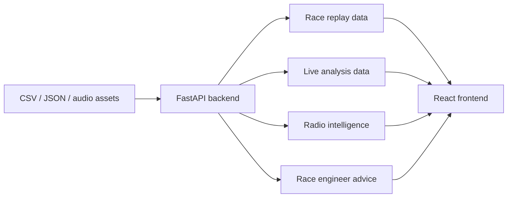

# Grand Prix Racing Intelligence Platform

Grand Prix is a motorsport analytics and storytelling workspace built around two layers: a Python backend that serves race intelligence from timing, telemetry, and radio assets, and a React frontend that presents that information through replay, live analysis, and voice-driven views.

The repository is structured to support fast local development, reproducible data processing, and presentation-ready race analysis without depending on a database or external application server.

## What the project does

- Serves race intelligence from static CSV, JSON, and audio assets under `data/`.
- Exposes FastAPI endpoints for grid data, replay playback, live analysis, radio intelligence, and race-engineer guidance.
- Presents the data through a Vite + React frontend with dedicated pages for the home experience, live intelligence, and voice features.
- Keeps the data model file-based so the project can be run locally with minimal setup.

## Repository layout

```text
grandPrix/
├─ backend/              # FastAPI application and analysis services
├─ data/                 # Race timing, telemetry, audio, and derived assets
├─ f1-frontend/          # Vite + React application
├─ F1_Frontend_PRD.md    # Product direction and feature context
└─ ZERO-PIT/             # Separate nested repository present in the workspace
```

## Architecture overview

The system is split into two main components:

1. The backend loads race data from the local filesystem and transforms it into API responses.
2. The frontend consumes those responses and renders the experience as a polished race dashboard.



## Key features

- Home experience with hero content, mission framing, race replay, driver insights, and closing sections.
- Live intelligence page for driver-centric analysis of session data.
- Voice page for radio-oriented storytelling and transcription-driven interactions.
- Backend services for replay assembly, live analysis, race context, and radio intelligence.
- Static track and telemetry assets stored alongside the code for deterministic local execution.

## Prerequisites

- Python 3.11 or newer.
- Node.js 20 or newer.
- npm.

The backend depends on `fastapi`, `uvicorn`, and `pandas`. The service modules also reference `numpy`, `requests`, and `whisper`, so ensure the local Python environment includes the packages required by your chosen run path.

## Backend setup

From the `backend/` directory:

```bash
python -m venv .venv
.venv\Scripts\activate
pip install -r requirements.txt
uvicorn main:app --reload
```

The API will listen on the default Uvicorn host and port unless overridden.

## Frontend setup

From the `f1-frontend/` directory:

```bash
npm install
npm run dev
```

To validate the frontend build:

```bash
npm run build
```

## API endpoints

The backend exposes the following routes from `backend/main.py`:

- `GET /api/grid` returns driver grid data.
- `GET /api/replay/{session_key}/{driver_number}` returns replay data for a session and driver.
- `GET /api/live-analysis/{session_key}/{driver_number}` returns live analysis output.
- `GET /api/radio/{session_key}/{driver_number}` returns radio intelligence.
- `POST /api/race-engineer` accepts corner metrics and returns race-engineer advice.

## Frontend routes

The frontend routes are defined in `f1-frontend/src/App.tsx`:

- `/` home experience.
- `/live` live intelligence view.
- `/voice` voice intelligence view.

## Data files

The `data/` directory contains the static inputs and derived artifacts used by the backend. These include:

- Lap, interval, position, stint, and race-control datasets.
- Per-driver telemetry traces and location samples.
- Race radio metadata and audio assets.
- Derived analysis JSON used by the replay and live-analysis services.

Treat these files as source assets for the application. If you regenerate them, keep the structure stable so the backend and frontend continue to resolve the same paths.

## Development notes

- The project is file-backed rather than database-backed.
- The frontend and backend can be run independently during development.
- Large telemetry and audio assets are committed directly to the repository so the application can be reproduced offline.
- The workspace also contains a separate nested repository at `ZERO-PIT/`; it is not part of the `grandPrix` application itself.

## Suggested workflow

1. Start the backend service.
2. Start the frontend development server.
3. Open the frontend in a browser and use the live and voice routes to verify the integrated experience.
4. Rebuild the frontend and rerun the backend if any data assets change.

## License

Refer to the repository license, if present, for usage terms.
