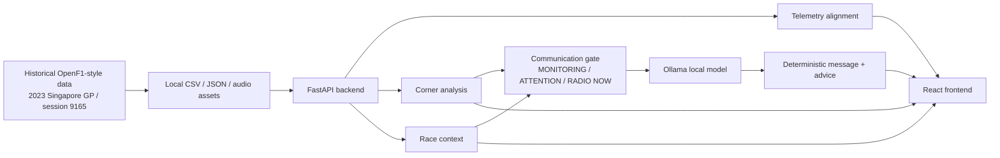

# The Silent Co-Driver

The Silent Co-Driver is an F1 hackathon project that turns historical OpenF1-style data from the 2023 Singapore Grand Prix into a simulated race-engineer experience. The system does not connect to live timing feeds in the current codebase. Instead, it replays local CSV, JSON, and audio assets to approximate a real-time co-driver session.

The product is split into a Python backend and a React frontend. The backend performs telemetry alignment, corner analysis, race-context derivation, radio transcription, and local LLM prompting. The frontend presents the output as a premium F1 engineering interface with a home page, a dedicated Live Intelligence page, and a radio-focused Voice page.

## Overview

The implementation is designed around evidence-first decision support:

1. Historical race data is loaded from local files.
2. Target-driver telemetry is aligned against a benchmark driver.
3. Corner-level deltas, race context, and confidence gating are computed deterministically.
4. Ollama is used only as the wording/reasoning layer for concise engineer instructions.
5. The frontend renders the result as LIVE ANALYSIS, RACE CONTEXT, and RADIO NOW experiences.

The repository is intentionally file-backed so the hackathon demo can run offline once the local assets and dependencies are in place.

## What It Does

- Simulates a live race-engineer workflow from historical 2023 Singapore Grand Prix data.
- Compares a target driver against a benchmark driver on a corner-by-corner basis.
- Computes normalized track progress, current corner, corner phase, and performance deltas.
- Applies a communication gate so the system can remain in MONITORING mode until the issue is material enough to justify ATTENTION or RADIO NOW.
- Uses a local Ollama model for concise instruction generation, with deterministic fallback advice if the model is unavailable.
- Provides a radio browser that downloads team radio clips, transcribes them locally, and aligns them with telemetry and race context.
- Presents the experience through a product-style landing page plus dedicated live and voice routes.
- Provides a unified Race Timeline that merges meaningful telemetry, radio, race-context, communication, and co-driver transitions.

## Key Features

| Area | Implemented behavior |
|---|---|
| Landing page | Presentation-first hero, mission strip, voice teaser, race replay teaser, drivers wall, montage, closing section, and footer |
| Live Intelligence | Historical telemetry playback with 1x, 2x, 5x, 10x, and 20x speeds, current-corner identification, benchmark comparison, race-context overlay, and communication gating |
| Corner analysis | Approximate corner windows for the 2023 Singapore track, entry/minimum/exit speed comparison, braking timing, throttle timing, and estimated time loss |
| Race context | Position, driver-behind lookup, gap-behind lookup, battle detection, and defending-state inference from interval/position history |
| Radio / Voice | Team radio ingestion, Hugging Face transcription/emotion signals, telemetry alignment, and radio intelligence rendering |
| Local LLM | Ollama chat endpoint with deterministic JSON-based advice generation and fallback summaries |

## Tech Stack

### Frontend

| Package | Version |
|---|---:|
| React | 19.2.8 |
| React DOM | 19.2.8 |
| React Router DOM | 7.18.2 |
| Vite | 8.2.0 |
| TypeScript | ~6.0.2 |
| @vitejs/plugin-react | 6.0.4 |
| Tailwind CSS | 4.3.3 |
| @tailwindcss/vite | 4.3.3 |
| GSAP | 3.15.0 |
| Motion | 13.1.0 |
| lucide-react | 1.31.0 |
| three | 0.185.1 |
| ogl | 1.0.11 |
| clsx | 2.1.1 |
| tailwind-merge | 3.6.0 |

### Backend

The checked-in `backend/requirements.txt` includes:

- `fastapi`
- `uvicorn`
- `pandas`
- `numpy`
- `requests`
- `torch`
- `transformers`
- `accelerate`
- `librosa`
- `soundfile`

The voice service uses Hugging Face Transformers for `openai/whisper-large-v3` and `superb/wav2vec2-base-superb-er`. The models are loaded lazily on the first voice request. Set `HF_TOKEN` only if the selected Hub resources require authentication; do not expose it to the frontend.

## How It Works

The execution path is:

1. Historical timing, location, car telemetry, and radio assets are read from `data/`.
2. `backend/services/live_analysis.py` loads the target and benchmark laps, normalizes progress, and synchronizes samples by lap progress.
3. `backend/data/singapore_2023_track.py` provides approximate corner windows for the Singapore track.
4. Corner metrics are derived from entry speed, minimum speed, exit speed, braking timing, and throttle timing.
5. `backend/services/race_context.py` enriches each sample with position, gap, and battle context.
6. The communication gate decides whether the current issue stays in MONITORING, moves to ATTENTION, or escalates to RADIO NOW.
7. If escalation is justified, `backend/services/race_engineer.py` calls Ollama and turns the deterministic metrics into concise instruction text.
8. The React frontend consumes the API and renders the current state as a live engineering cockpit.



## Live Intelligence

The Live Intelligence page is the core product surface and is mounted at `/live`.

It is currently wired in code to session `9165` and driver `1`, which matches the Singapore 2023 demo dataset. The page progressively simulates a live race by advancing through the historical samples at the selected playback speed.

Implemented behavior:

- Playback speeds: `1x`, `2x`, `5x`, `10x`, and `20x`.
- Current section detection from normalized lap progress.
- Track-map rendering of the target driver and other drivers.
- Comparison of the target driver against the selected benchmark driver.
- Contextual telemetry cards for entry speed, minimum speed, exit speed, braking delta, and throttle delay when the current diagnosis is actionable.
- Race context display for position and battle state.
- A co-driver briefing panel that moves between MONITORING, ATTENTION, and RADIO NOW.

Important implementation detail: the frontend does not request live OpenF1 data. It calls the local backend and replays the historical session data as if it were arriving in real time.

## Corner Analysis

Corner analysis is implemented in `backend/services/live_analysis.py` using the Singapore-specific corner table in `backend/data/singapore_2023_track.py`.

### Normalized progress

Each lap is converted to a progress value in the range `0.0` to `1.0` by computing cumulative Euclidean distance along the sampled telemetry points. The frontend then renders positions on a `0-100` scale.

### Target vs benchmark synchronization

The target lap and benchmark lap are synchronized by `progress_float` using `pandas.merge_asof(...)`, which aligns the nearest benchmark point to each target sample.

The benchmark driver is selected from the same session and lap by choosing the fastest valid lap from another driver. The target driver is explicitly excluded from being its own benchmark. If no valid comparable lap is available, the code falls back to a fixed driver choice.

### Corner windows and phases

The Singapore track configuration uses approximate progress windows for corners `T1` through `T19`. These are calibrated ranges, not official FIA geometry.

For each sample, the code derives one of the following phases:

- `APPROACH`
- `BRAKING`
- `CORNER`
- `EXIT`

### Metrics used

For each corner window the backend computes:

- entry speed delta
- minimum speed delta
- exit speed delta
- braking progress delta
- throttle delay
- estimated time loss over the corner window

### Deterministic diagnoses

The current implementation assigns diagnoses using fixed rules:

| Diagnosis | Rule in code |
|---|---|
| `EARLY_BRAKING` | braking progress is earlier than benchmark by more than `0.005` and entry speed is more than `5 km/h` slower |
| `LOW_ENTRY_SPEED` | entry speed is more than `10 km/h` slower |
| `LOW_MIN_SPEED` | minimum speed is more than `7 km/h` slower |
| `LATE_THROTTLE` | throttle application is later than benchmark by more than `0.005` progress units |
| `LOW_EXIT_SPEED` | exit speed is more than `8 km/h` slower |

If none of those rules match, the corner is treated as `GOOD`.

### Confidence and time-loss handling

The analysis currently assigns a fixed confidence value of `0.85` to actionable corner metrics and uses `0.99` for the fallback "keep pushing" state. Time loss is estimated from elapsed-time differences across the corner window, then passed through the communication gate.

## Race Context

`backend/services/race_context.py` uses `position.csv` and `intervals.csv` to add race-state metadata to each sample.

Implemented behavior:

- Current position is derived from the latest position sample at or before the telemetry timestamp.
- The driver behind is the car in the next position at that timestamp.
- `gap_behind` is taken from the most recent valid interval sample for that car.
- `battle_active` becomes true when the last two valid intervals for the driver behind are both below the configured battle threshold.
- `is_defending` is set when a battle is active and the driver is ahead of the tracked rival.
- `position_event` is set to `POSITION_GAIN`, `MULTI_POSITION_GAIN`, `POSITION_LOSS`, or `MULTI_POSITION_LOSS` when a recent position change is detected.
- Interval data older than the configured age limit is ignored so stale gaps do not keep the system in an outdated state.

Configured thresholds in the current code:

- battle gap threshold: `0.25`
- minimum valid observations: `2`
- maximum interval age: `15.0` seconds

The code does not currently infer a separate "attacking" state with the same confidence as defending; it is primarily a defending/battle-active model.

## Communication Gate

The communication gate exists so the system can analyze continuously without interrupting the driver on every sample.

The states are:

- `MONITORING` when the sample is clean, on a straight, or otherwise not actionable.
- `ATTENTION` when the sample is non-trivial but not yet ready for radio.
- `RADIO_NOW` when the issue is material enough to justify a spoken instruction.

The current gate uses these thresholds:

- minimum radio confidence: `0.80`
- minimum radio time loss: `0.10`
- high-severity immediate escalation: `0.20`
- minimum persistence: `2` consecutive laps for the same corner+diagnosis key
- radio cooldown: `20` seconds
- material worsening delta: `0.10`

How the gate behaves:

- Issues are deduplicated by corner name plus diagnosis.
- A repeated issue can remain in `RADIO_NOW` if it is still the active radio event.
- A new radio message can be triggered immediately when the issue materially worsens, even if the cooldown has not expired.
- Otherwise the gate waits for cooldown expiry.
- Deterministic fallback advice is still attached if Ollama is unavailable.

## Local LLM / Ollama

`backend/services/race_engineer.py` is the reasoning layer for the co-driver instruction.

Current implementation details:

- Ollama endpoint: `http://localhost:11434/api/chat`
- Model: `llama3.1:latest`
- Temperature: `0.2`
- Output format: JSON-only response with a `corners` array

The backend sends deterministic corner metrics plus optional race context to the model. The model is asked to produce short observation and advice text only. It does not compute telemetry values, diagnoses, or time loss itself.

If Ollama is unavailable, times out, or returns invalid JSON, the backend falls back to deterministic advice strings generated from the corner diagnosis.

Ollama host and model can be overridden with `OLLAMA_URL` and `OLLAMA_MODEL`; defaults remain local Ollama values.

## Radio / Voice

The repository contains a real radio intelligence flow at `/voice`, but it is important to distinguish it from the decorative landing-page teaser.

Implemented in the backend:

- `team_radio.csv` is filtered by session and driver.
- Audio clips are downloaded to `data/radio_audio/` when needed.
- Hugging Face `openai/whisper-large-v3` transcribes downloaded audio locally.
- Hugging Face `superb/wav2vec2-base-superb-er` returns the model's actual emotion labels and probabilities.
- A conservative `voice_state` (`CALM`, `ELEVATED`, or `HIGH_INTENSITY`) is derived from the model's neutral probability; it is not stress or psychological diagnosis.
- The selected emotion model currently returns `neu`, `hap`, `ang`, and `sad`; the UI displays those labels in uppercase without renaming them.
- The radio timestamp is aligned to the nearest target telemetry sample when the match is within 5 seconds, with lap-bounded normalized progress.
- Track context, deterministic performance analysis, communication-gate state, and race context are attached to each radio message.
- Transcript, emotion, and Ollama interpretation results are cached under `data/radio_transcripts/` and `data/voice_analysis/`.
- The transcript, voice signals, and structured race evidence are passed to Ollama for race-engineer wording only.

Implemented in the frontend:

- The Voice page lists transmissions, transcript status, track context, performance context, and race context.
- An audio player allows playback of the associated clip.
- The landing-page `VoiceFeature` section is a stylized presentation component and is not the same thing as the radio browser page.

Limitations of the current voice implementation:

- It is transcript- and context-driven, not acoustic stress analysis.
- If audio download or either Hugging Face model fails, the affected signal is marked unavailable and the page remains usable.
- The emotion model is a vocal emotion classifier; its output must not be interpreted as direct stress, fatigue, or mental-state detection.

## Corner History

There is not currently a standalone corner-history route or dedicated corner-history browser in the active app.

What does exist is the historical corner-analysis logic inside `live_analysis.py`, which already compares the target lap against the benchmark lap on a corner-by-corner basis. The Live Intelligence page exposes those computed metrics while the historical session is replayed, but users cannot yet click into a separate corner-history endpoint or compare arbitrary lap histories from a dedicated screen.

In other words:

- implemented: historical corner comparison inside LIVE ANALYSIS
- not implemented: a separate clickable corner-history API or route

## Data Sources

The top-level `data/` directory is the source of truth for the current application.

| File or folder | Used for |
|---|---|
| `drivers.csv` | Driver grid metadata for the home page and driver cards |
| `laps.csv` | Lap metadata, lap numbers, start timestamps, and lap durations |
| `car_data_{driver}.csv` | Per-driver car telemetry such as speed, throttle, brake, gear, rpm, and DRS |
| `location_{driver}.csv` | Per-driver XY track position used for replay and progress normalization |
| `intervals.csv` | Gap data for race-context and battle detection |
| `position.csv` | Position history for race-context state and position changes |
| `team_radio.csv` | Radio metadata and recording URLs |
| `data/radio_audio/` | Downloaded or committed MP3 radio clips |
| `analysis/analysis.json` | Derived analysis artifact used by the existing data pipeline |
| `analysis/telemetry.csv` | Derived telemetry export used by the existing data pipeline |
| `cache_9165_1.json` | Derived cache for the 2023 Singapore demo session |
| `race_control.csv` | Present in the repository, but not currently consumed by the active backend services |

The repository also contains helper caches such as `backend/services/llm_cache.json` and runtime radio cache files created during execution.

## API

The FastAPI application lives in `backend/main.py`.

| Method | Path | Purpose | Parameters | Response |
|---|---|---|---|---|
| `GET` | `/api/grid` | Returns the driver grid used by the frontend driver wall | none | `{ "drivers": [...] }` |
| `GET` | `/api/replay/{session_key}/{driver_number}` | Returns replay data for a session, driver, and lap | path params `session_key`, `driver_number`; query param `lap` defaults to `2` | Session metadata, lap number, lap duration, and normalized telemetry samples |
| `GET` | `/api/live-analysis/{session_key}/{driver_number}` | Returns the live-analysis sample stream for the selected target driver | path params `session_key`, `driver_number` | Target driver, benchmark driver, lap number, and an ordered list of analysis samples |
| `GET` | `/api/voice/{session_key}/{driver_number}` | Returns cached Hugging Face voice intelligence for the selected driver | path params `session_key`, `driver_number` | Session/driver metadata, model identifiers, and messages with audio, transcript, emotion signals, aligned performance, race context, communication state, and Ollama interpretation |
| `GET` | `/api/radio/{session_key}/{driver_number}` | Compatibility alias for the voice endpoint | path params `session_key`, `driver_number` | Same response as `/api/voice` |
| `GET` | `/api/race-timeline/{session_key}/{driver_number}` | Merges existing live, voice, race-context, gate, and co-driver transitions | path params `session_key`, `driver_number` | Chronologically ordered shared event context with links back to `/live` and `/voice` |
| `POST` | `/api/race-engineer` | Generates race-engineer advice from corner metrics | JSON body: `{ "corner_metrics": { ... } }` | Corner-keyed message/advice output from the Ollama reasoning layer or fallback logic |

There is no `/api/corner-history` route in the current codebase.

## Project Structure

```text
grandPrix/
├─ backend/
│  ├─ main.py                 # FastAPI app and route definitions
│  ├─ data/                   # Track configuration and data-prep helpers
│  └─ services/               # Drivers, replay, live analysis, race context, voice, timeline, race engineer
├─ data/                      # Historical timing, telemetry, radio, and derived session assets
├─ f1-frontend/
│  ├─ src/App.tsx             # Router shell and loader gate
│  ├─ src/pages/              # Home, Live Intelligence, and Voice pages
│  ├─ src/components/         # Shared UI primitives and home-page sections
│  ├─ src/lib/api.ts          # Typed fetch helpers for backend endpoints
│  └─ vite.config.ts          # Vite config and local /api proxy
├─ F1_Frontend_PRD.md         # Product brief and feature direction
└─ ZERO-PIT/                  # Separate nested repository present in the workspace, not part of this app
```

The most important frontend sections are:

- `Hero`, `MissionStrip`, `VoiceFeature`, `RaceReplay`, `Drivers`, `Montage`, `Closing`, and `Footer` on the home page.
- `LiveIntelligencePage` for live analysis playback.
- `VoicePage` for radio/transcript exploration.
- `Navbar`, `Loader`, `DriftWall`, `TelemetryHUD`, and `WarpText` as shared UI elements.

## Setup

### Prerequisites

- Node.js 20 or newer.
- npm.
- A recent Python 3 interpreter.
- Ollama installed locally if you want the LLM-backed instruction layer.

### Backend installation

From `backend/`:

```powershell
python -m venv .venv
.\.venv\Scripts\Activate.ps1
pip install -r requirements.txt
```

The requirements install also downloads the Hugging Face model dependencies. The first `/voice` request downloads model weights from the Hub unless they are already present in the local Transformers cache.

### Frontend installation

From `f1-frontend/`:

```bash
npm install
```

### Ollama setup

The backend expects Ollama to be reachable at `http://localhost:11434` and uses the `llama3.1:latest` model name.

Typical local setup:

```bash
ollama pull llama3.1:latest
ollama serve
```

If Ollama is not running or the model is unavailable, the backend will still return deterministic fallback advice.

### Required data placement

The repository already includes the historical session assets under `data/`. Do not move those files unless you also update the file paths in the backend services.

## Running the Project

### Start the backend

From `backend/`:

```powershell
uvicorn main:app --reload --port 8000
```

### Start the frontend

From `f1-frontend/`:

```bash
npm run dev
```

The Vite development server proxies `/api` requests to `http://localhost:8000`.

### Validate the frontend build

From `f1-frontend/`:

```bash
npm run build
```

### Open the main routes

- `/` landing page.
- `/live` LIVE INTELLIGENCE.
- `/voice` RADIO NOW / Voice page.
- `/timeline` unified chronological race-event timeline.

## Environment Variables

The voice service reads the following optional environment variables:

Observed hardcoded runtime values include:

- Ollama endpoint: `http://localhost:11434/api/chat`
- Ollama model: `llama3.1:latest`
- `HF_TOKEN`: optional Hugging Face Hub token for model access
- `OLLAMA_URL`: optional Ollama chat endpoint override
- `OLLAMA_MODEL`: optional Ollama model override
- Frontend demo session: `9165`
- Frontend demo target driver: `1`

## Limitations

- The project uses historical data to simulate real-time behavior; it does not connect to live OpenF1 streams in the current code.
- Corner geometry is an approximate progress-based calibration, not an official track survey.
- The target session and driver are hardcoded in the current frontend demo pages.
- Race-context confidence depends on the freshness of interval samples and the configured age limit.
- Ollama must be available locally for generated radio advice; otherwise the backend falls back to deterministic text.
- The voice experience exposes Hugging Face transcript and vocal-emotion signals; it is not acoustic stress analysis or psychological diagnosis.
- There is no standalone corner-history route or clickable corner-history browser yet.
- `race_control.csv` is present in the repo but is not wired into the active backend services.

## Future Work

- Add configurable session and driver selection in the frontend.
- Expose a dedicated corner-history route for arbitrary lap-by-lap comparisons.
- Broaden race-context reasoning beyond the current position/gap/battle model.
- Improve benchmark selection when the fastest valid comparable lap is not the most meaningful rival.
- Add richer voice analysis if acoustic features become part of the product scope.
- Integrate a true live OpenF1 source when the hackathon constraints are removed.

## Hackathon Demo Flow

1. Start the backend on port `8000`.
2. Start the frontend on Vite's development server.
3. Open the landing page and use it as the product presentation layer.
4. Open `/live` to watch the historical Singapore session replay as LIVE INTELLIGENCE.
5. Open `/voice` to inspect RADIO NOW, transcript status, and AI interpretation.
6. Switch playback speed to see how the communication gate reacts as the session advances.

## License

No license file is present at the repository root at the moment.
