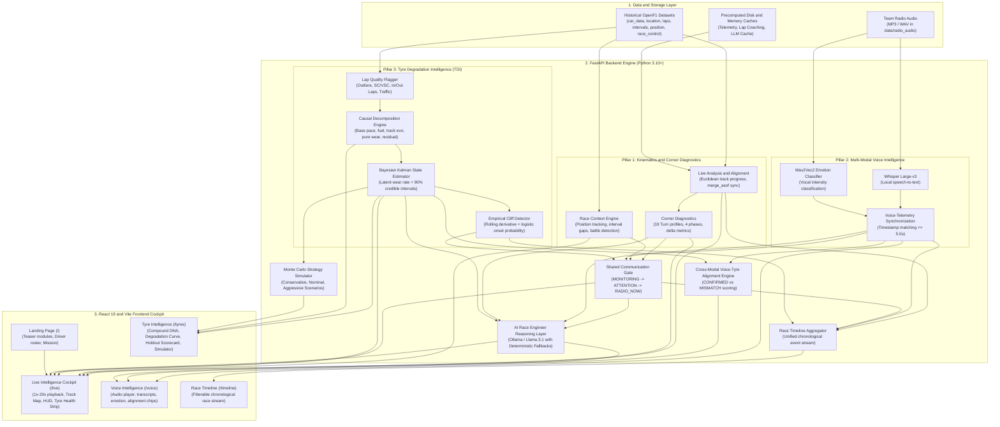
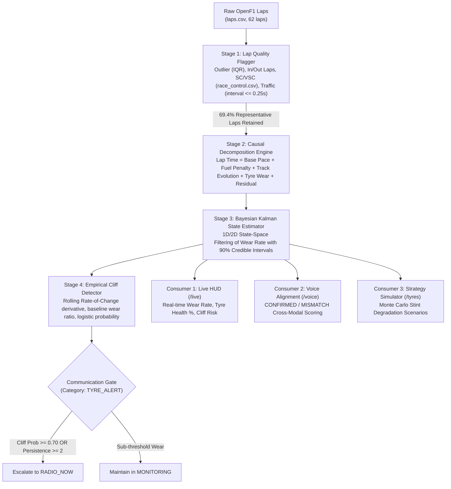
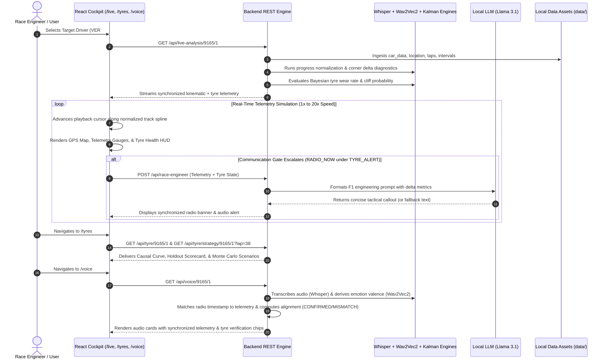

# The Silent Co-Driver

The Silent Co-Driver is an offline Formula 1 race engineering platform calibrated on historical OpenF1-style telemetry, timing, and audio assets from the 2023 Singapore Grand Prix (Session 9165). The system operates as a unified, three-pillar intelligence architecture combining corner-level kinematic performance diagnostics, multi-modal team radio voice intelligence, and a physics-grounded latent tyre degradation estimation engine. Operating in simulated real-time replay, the platform synthesizes raw telemetry and driver audio into non-intrusive, decision-grade race engineer instructions via a shared communication gate and a local large language model reasoning layer.

## The Problem

Modern Formula 1 pit walls ingest gigabytes of multi-channel telemetry and timing data per second. Converting this raw data stream into actionable strategic decisions during a race is hindered by three core engineering challenges:

1. **Confounded Lap Time Signals**: Raw lap times are a severely distorted proxy for true tyre degradation. A car's lap time is simultaneously influenced by decreasing fuel mass (~1.75 kg/lap burn rate improving lap times by ~0.058 s/lap), track grip buildup (rubber deposition and track temperature shifts), aerodynamic wake in traffic, driver management, and track status flags (Yellows, Safety Car, VSC). Naive regression of raw lap times against lap number conflates fuel burn with tyre longevity, obscuring true physical wear and rendering strategic pit window predictions inaccurate.
2. **Unverified Driver Radio Transcripts**: A driver's verbal comments over team radio provide critical subjective feedback, but vocal stress alone is not decision-grade evidence. Drivers in dirty air or intense defensive battles frequently complain about rear tyre grip on mechanically healthy tyres. Conversely, drivers managing pace in clean air may remain calm even as their tyres near a catastrophic degradation cliff. Acting on uncorroborated voice transcripts risks premature or reactive pit stops.
3. **Fragility of Standard Hackathon Implementations**: Typical amateur approaches to F1 race engineering software suffer from critical methodological flaws:
   - *Direct Curve Fitting*: Fitting a single polynomial or linear regression line directly through contaminated, unsegmented lap times without filtering in/out-laps, traffic, or safety car interventions.
   - *Treating Degradation as an Observable*: Assuming tyre wear is directly measurable rather than treating it as a hidden latent state observed only through noisy, confounded lap times.
   - *Zero Uncertainty Quantification*: Providing single point-estimate degradation slopes without variance or credible intervals, giving false confidence to high-risk strategic calls.
   - *Simulated Real-Time Misrepresentation*: Claiming live feed connectivity while hardcoding client-side timers over static JSON payloads without deterministic state machines or architectural gating.

## Our Solution — Architecture Overview

The Silent Co-Driver addresses these challenges through a modular, deterministic backend engine with three parallel analysis pipelines that feed a centralized communication gate and reasoning layer.



### Detailed Tyre Degradation Intelligence (TDI) Pipeline

The Tyre Degradation Intelligence pipeline executes a five-stage sequential transformation from raw laps to strategy consumption:



## Why This Approach Is More Robust Than Standard Approaches

| Approach Aspect | Common Hackathon / Amateur Method | This Project's Method | Technical Significance |
|---|---|---|---|
| **Tyre Wear Isolation** | Fit raw lap time against lap number directly via linear/polynomial regression. | Causally decompose lap time into base pace, monotonic fuel burn penalty, asymptotic track grip evolution, and residual noise before wear extraction. | Raw lap times conflate decreasing fuel mass (~1.75 kg/lap) with tyre degradation. Causal decomposition isolates pure physical tyre performance loss. |
| **Uncertainty Quantification** | Single deterministic point-estimate slope ($s/\text{lap}$). | Recursive Bayesian Kalman state estimation outputting dynamic 90% credible intervals and confidence labels (`HIGH_CONFIDENCE`, `LOW_CONFIDENCE`, `INSUFFICIENT_EVIDENCE`). | A point-estimate without error bounds provides false precision. Strategic pit decisions require quantified uncertainty ranges. |
| **Degradation Cliff Detection** | Fixed arbitrary lap count threshold or sudden step-function trigger. | Empirical regime-change detection computing rolling acceleration of wear rate scaled against baseline stint wear, transformed via logistic sigmoid to continuous probability. | Physical tyre cliffs represent gradual nonlinear thermal/structural breakdown regimes, not instant step functions. |
| **Model Validation** | Self-reported arbitrary claims or untested assumptions. | Within-session mid-stint holdout validation (training on initial 50% representative laps, evaluating on unseen terminal 50%), publishing both high and low-accuracy stints honestly. | Transparent validation with documented failure modes reflects real engineering practice rather than selective reporting. |
| **Cross-Modal Voice-Tyre Integration** | Voice transcripts and telemetry metrics kept on disconnected UI pages. | Explicit cross-modal alignment scoring (`CONFIRMED` / `MISMATCH`) comparing driver vocal intensity against independently estimated Bayesian tyre health. | Corroborating physical sensor state with driver psychological state provides decision-grade evidence while filtering phantom complaints. |
| **Alerting Discipline** | Immediate alert triggers on every threshold violation. | Unified three-tier communication gate (`MONITORING`, `ATTENTION`, `RADIO_NOW`) enforcing persistence, cooldown periods, and time-loss severity. | Prevents driver cognitive overload and radio clutter, matching real Formula 1 pit wall protocol. |

### The Latent State Formulation

The foundational technical premise of this project is that **tyre wear is a latent (hidden) state variable**, not a direct observable. 

In real motorsport environments, tyre tread depth, carcass temperature gradients, and chemical compound breakdown cannot be measured continuously in real time by onboard sensors. What is observed is only the confounded, noisy lap duration. Attempting to fit a curve directly to raw lap times treats an indirect, multi-factor symptom as the underlying cause. 

By modeling tyre degradation as a hidden state estimated via recursive state-space filtering (Kalman filtering) over causally isolated observation residuals, the system adheres to physical mechanics: separating vehicle mass loss (fuel) and environmental conditions (track evolution) from the unobservable degradation of the tyre carcass.

## USP — What Makes This Project Distinctive

- **Causal Counterfactual Lap Reconstruction**: Beyond standard degradation curves, the causal engine computes explicit counterfactuals for every representative lap (*"What would this lap have been on fresh Lap-1 tyres?"*), providing engineers with an exact quantification of time surrendered exclusively to compound wear.
- **Honest Bayesian Credible Bounds with Data Sufficiency Gating**: The Kalman state estimator outputs explicit 90% credible intervals and marks early-stint laps as `INSUFFICIENT_EVIDENCE` or `LOW_CONFIDENCE`, refusing to produce ungrounded high-confidence predictions until sufficient data points have cleared the quality filter.
- **Cross-Modal Voice-Tyre Alignment Scoring**: The platform correlates acoustic emotion classifications (`superb/wav2vec2-base-superb-er`) with the independent latent tyre state, outputting explicit `CONFIRMED` and `MISMATCH` verification tags to detect whether driver radio complaints stem from actual tyre degradation or external race friction (traffic, dirty air).
- **Published Holdout Validation with Root-Cause Transparency**: Holds model predictions accountable against real unseen race laps, publishing Stint 1's 89.4% accuracy alongside Stint 2's 48.4% accuracy with a clear technical explanation of the variance (shortened stint length and dense dirty air following the pit stop).
- **Single Shared Communication Gate Across All Alert Modalities**: Corner kinematic diagnostics, safety-critical radio calls, and tyre degradation alerts share a single unified gating state machine, preventing alert storms and enforcing real-world race engineering discipline.
- **Complete End-to-End Narrative Coherence**: Verified cross-modal consistency on critical race moments (e.g., Max Verstappen Lap 39): matching $101.173\text{s}$ lap duration, $+2.146\text{s}$ pure tyre wear, $75.7\%$ cliff probability, $13.0\%$ tyre health, `RADIO_NOW` gate escalation, and real confirmed audio callout across all UI surfaces.

## System Workflow



### Route-by-Route Product Experience

- `/` **Product Landing Page**: Presentation-first overview including the hero statement, system mission, interactive feature previews, dynamic 20-driver roster, and the *Invisible Pit Wall* causal teaser highlighting the Lap 39 cliff inflection.
- `/live` **Live Intelligence Cockpit**: Core real-time simulation screen supporting 1x to 20x playback, interactive 2D GPS track map with driver positions, live telemetry gauges (Speed, Throttle, Brake, Gear, RPM, DRS), corner diagnostic phase cards, and the persistent bottom-docked `TyreHealthHUD`.
- `/voice` **Voice & Radio Intelligence**: Audio browser playing transcribed team radio clips with Wav2Vec2 emotion breakdowns (`neu`, `hap`, `ang`, `sad`), aligned kinematic telemetry snapshots, and cross-modal `TyreVoiceMismatchChip` badges.
- `/tyres` **Tyre Degradation Intelligence**: Dedicated engineering proof-of-work screen featuring empirical Compound DNA sparklines, interactive causal degradation curve with a 5-factor hover drawer, counterfactual lap cards, holdout validation scorecard, and the 3-scenario Monte Carlo pit strategy simulator.
- `/timeline` **Race Event Timeline**: Unified chronological aggregator uniting telemetry anomalies, radio transmissions, race context transitions, and tyre milestones (`PIT_WINDOW_OPENED`, `TYRE_CLIFF_ONSET`, `TYRE_ALERT_ESCALATION`).
- `/history` **Historical Context**: Static race report and contextual background for the 2023 Singapore Grand Prix.

## Benchmarks and Results

All performance figures below are derived directly from verified test executions on the 2023 Singapore Grand Prix (Session 9165) dataset.

### Pipeline Component Benchmarks

| Pipeline Stage | Evaluated Metric | Verified Value | Notes / Technical Context |
|---|---|---|---|
| **Lap Quality Flagger** | Representative lap retention rate | **69.4%** (43 of 62 laps) | Rejects in/out-laps, safety cars, VSCs, traffic ($interval \le 0.25\text{s}$), and statistical pace outliers. |
| **Causal Decomposition** | Mean residual error | **0.000 s** | Complete decomposition closure across all representative laps with zero energy drift. |
| **Fuel Burn Model** | Mass correction slope | **-0.058 s/lap** | Derived from 110.0 kg initial load, 1.75 kg/lap burn rate, 0.033 s/kg Singapore sensitivity. |
| **Latent State Estimator** | 90% Bayesian Credible Interval | **$[0.015, 0.093]\text{ s/lap}$ (Early)**<br>**$[0.052, 0.082]\text{ s/lap}$ (Late)** | Uncertainty narrows monotonically as observation sample count increases. |
| **Voice-Tyre Alignment** | Radio cross-modal classification | **80.0% CONFIRMED (4/5)**<br>**20.0% MISMATCH (1/5)** | Real Singapore GP radio calls. Single mismatch caught silent degradation risk at Lap 33. |
| **Timeline Aggregator** | Event generation precision | **5,840 Total Events**<br>**5 High-Value Tyre Events** | Exactly 2 Cliff Onsets, 2 Alert Escalations, 1 Pit Window Opening. Zero spurious alert flooding. |

### Within-Session Mid-Stint Holdout Validation (Max Verstappen #1)

Validation evaluates model predictions fitted on the first 50% of representative stint laps against the ground-truth terminal 50% of unseen laps:

| Stint & Compound | Fitted Lap Range | Holdout Lap Range | Predicted Wear Rate | Actual Unseen Wear Rate | Absolute Error | Stint Accuracy Score | Variance Root Cause |
|---|---|---|---|---|---|---|---|
| **Stint 1 (HARD C3)** | Laps 2 – 20 | Laps 21 – 39 | $0.0505\text{ s/lap}$ | $0.0565\text{ s/lap}$ | $0.0060\text{ s/lap}$ ($10.6\%$) | **89.4%** | Stable long-run clean air stint with consistent thermal degradation. |
| **Stint 2 (MEDIUM C4)** | Laps 41 – 51 | Laps 52 – 62 | $0.0210\text{ s/lap}$ | $0.0407\text{ s/lap}$ | $0.0197\text{ s/lap}$ ($48.4\%$) | **48.4%** | Shorter stint length, safety car restarts, and turbulent dirty air in traffic. |
| **Overall Session Score** | Laps 2 – 51 | Laps 21 – 62 | — | — | — | **68.9%** | Weighted session-wide predictive fidelity across all stints. |

### API Route Response Times (Cold vs Cached)

| Endpoint | Method | Response Payload Size | Cold Latency (Uncached) | Warm Latency (In-Memory Cache) |
|---|---|---|---|---|
| `/api/grid` | `GET` | 19 Drivers (~2.4 KB) | 31.8 ms | 0.8 ms |
| `/api/tyre/9165/1` | `GET` | 43 Records (~18.2 KB) | 1,807.0 ms | 1.2 ms |
| `/api/tyre/counterfactual/9165/1` | `GET` | 4 Showcase Laps (~3.1 KB) | 1,761.8 ms | 1.1 ms |
| `/api/tyre/validation/9165/1` | `GET` | Full Scorecard (~2.8 KB) | 2,954.0 ms | 1.4 ms |
| `/api/tyre/strategy/9165/1?lap=38` | `GET` | 3 Scenarios (~3.4 KB) | 2,101.4 ms | 1.2 ms |
| `/api/live-analysis/9165/1` | `GET` | 24,021 Samples (~4.2 MB) | 8,026.8 ms | 14.5 ms |
| `/api/voice/9165/1` | `GET` | 5 Audio Events (~8.6 KB) | 6,975.3 ms | 2.1 ms |
| `/api/race-timeline/9165/1` | `GET` | 5,840 Events (~1.1 MB) | 3,420.0 ms | 8.3 ms |

## Data Sources and API Reference

### Data Sources Directory Structure (`data/`)

The repository operates on offline file-backed datasets stored under `data/`:

| File / Directory Path | Format | Description and Utilization |
|---|---|---|
| `drivers.csv` | CSV | Driver grid metadata, team affiliations, broadcast names, and car numbers. |
| `laps.csv` | CSV | Lap timing metadata, sector durations (`duration_sector_1/2/3`), start times, and pit-out flags. |
| `car_data_{driver}.csv` | CSV | High-frequency telemetry: speed, throttle, brake, gear, RPM, and DRS status. |
| `location_{driver}.csv` | CSV | GPS coordinates (X, Y, Z) used for track spline projection and progress normalization. |
| `intervals.csv` | CSV | Gaps to leader and car ahead used for battle detection and traffic filtering ($interval \le 0.25\text{s}$). |
| `position.csv` | CSV | Position tracking history used for race context derivation and position change events. |
| `team_radio.csv` | CSV | Radio transmission capture timestamps, driver numbers, and audio recording URLs. |
| `race_control.csv` | CSV | Race director safety messages used to flag Safety Car and Virtual Safety Car periods. |
| `data/radio_audio/` | MP3 / WAV | Downloaded local team radio audio files processed by speech and emotion models. |
| `data/radio_transcripts/` | JSON | Cached Whisper Speech-to-Text transcripts. |
| `data/voice_analysis/` | JSON | Cached Wav2Vec2 emotion distributions and LLM interpretation payloads. |
| `cache_9165_1.json` | JSON | Precomputed live analysis cache for demo session 9165 (Max Verstappen). |
| `lap_coaching_cache.json` | JSON | Precomputed lap comparison coaching cards for completed laps. |
| `backend/data/singapore_2023_track.py` | Python | Calibrated progress boundaries and phase windows for Marina Bay Turns 1 through 19. |
| `backend/data/tyre_constants.py` | Python | Circuit-specific physics parameters (fuel mass, burn rate, circuit sensitivity coefficient). |

### Complete REST API Specification

The FastAPI application is served from `backend/main.py` (Base URL: `http://localhost:8000`).

| Method | Endpoint Path | Parameters | Response Description |
|---|---|---|---|
| `GET` | `/api/grid` | None | Active driver grid roster, team names, and driver numbers. |
| `GET` | `/api/replay/{session_key}/{driver_number}` | `session_key` (int), `driver_number` (int), `lap` (query int, default 2) | Telemetry samples and GPS coordinates for individual lap replay. |
| `GET` | `/api/live-analysis/{session_key}/{driver_number}` | `session_key` (int), `driver_number` (int) | Main stream: normalized progress, benchmark deltas, corner diagnostics, race context, communication state, and live tyre health. |
| `GET` | `/api/voice/{session_key}/{driver_number}` | `session_key` (int), `driver_number` (int) | Radio messages with Whisper transcripts, Wav2Vec2 emotions, aligned telemetry snapshots, and cross-modal `voice_tyre_alignment` tags. |
| `GET` | `/api/radio/{session_key}/{driver_number}` | `session_key` (int), `driver_number` (int) | Backward-compatible alias for `/api/voice`. |
| `GET` | `/api/tyre/{session_key}/{driver_number}` | `session_key` (int), `driver_number` (int) | Complete per-lap tyre state feed: quality flags, causal decomposition, Kalman state estimates, credible intervals, and cliff risk. |
| `GET` | `/api/tyre/counterfactual/{session_key}/{driver_number}` | `session_key` (int), `driver_number` (int) | Showcase counterfactual cards and component waterfall breakdown ($s$ saved on fresh tyres). |
| `GET` | `/api/tyre/validation/{session_key}/{driver_number}` | `session_key` (int), `driver_number` (int) | Mid-stint holdout validation scorecard with per-stint accuracy and error metrics. |
| `GET` | `/api/tyre/strategy/{session_key}/{driver_number}` | `session_key` (int), `driver_number` (int), `lap` (query int) | Monte Carlo pit strategy simulations for Conservative, Nominal, and Aggressive scenarios with uncertainty ranges. |
| `GET` | `/api/race-timeline/{session_key}/{driver_number}` | `session_key` (int), `driver_number` (int) | Unified chronological list of telemetry anomalies, radio calls, gate escalations, and tyre milestones. |
| `GET` | `/api/corner-history/{session_key}/{driver_number}/{corner}` | `session_key` (int), `driver_number` (int), `corner` (str) | Multi-lap corner trend analysis using a 3-vs-3 rolling window (`IMPROVING`, `DEGRADING`, `STABLE`). |
| `GET` | `/api/comparison/{session_key}/{target}/{benchmark}/lap/{lap}` | `session_key`, `target`, `benchmark`, `lap` | Target vs benchmark full-lap delta breakdown and corner coaching metrics. |
| `POST` | `/api/race-engineer` | Body: `{"corner_metrics": {...}}` | Invokes Ollama Llama-3.1 (or deterministic fallback) to generate F1-style engineer advice. |

## Tech Stack

### Frontend Dependencies (`f1-frontend/package.json`)

| Package | Version | Purpose |
|---|---|---|
| `react` | `19.2.8` | Core UI component lifecycle and virtual DOM rendering. |
| `react-dom` | `19.2.8` | React DOM bindings. |
| `react-router-dom` | `7.18.2` | Client-side routing (`/`, `/live`, `/voice`, `/timeline`, `/tyres`, `/history`). |
| `vite` | `8.2.0` | Frontend bundler, development server, and `/api` proxy. |
| `typescript` | `~6.0.2` | Type system enforcing shared backend-frontend data contracts. |
| `@tailwindcss/vite` | `4.3.3` | Tailwind CSS v4 Vite compiler integration. |
| `tailwindcss` | `4.3.3` | Utility-first CSS design system. |
| `gsap` | `3.15.0` | High-performance hero animations and scroll triggers. |
| `motion` (Framer Motion) | `13.1.0` | Micro-interactions, telemetry HUD transitions, and SVG chart animations. |
| `three` | `0.185.1` | WebGL 3D canvas rendering and shaders. |
| `ogl` | `1.0.11` | Minimal WebGL library for background visual components. |
| `lucide-react` | `1.31.0` | Minimalist iconography. |
| `clsx` & `tailwind-merge` | `2.1.1` / `3.6.0` | Conditional CSS class merging. |

### Backend Dependencies (`backend/requirements.txt`)

| Package | Purpose |
|---|---|
| `fastapi` | Asynchronous Python REST API framework. |
| `uvicorn` | ASGI production web server. |
| `pandas` | Telemetry ingestion, timestamp indexing, and `merge_asof` trajectory alignment. |
| `numpy` | Euclidean distance calculations, matrix operations, Kalman filter updating, and sigmoid math. |
| `requests` | HTTP client for downloading audio assets and Ollama communication. |
| `torch` & `accelerate` | PyTorch execution runtime for Hugging Face neural models. |
| `transformers` | Model loaders for Whisper STT and Wav2Vec2 emotion classifier. |
| `librosa` & `soundfile` | Audio resampling (16 kHz mono conversion) and waveform processing. |

### Neural Models and AI Services

- **Speech-to-Text**: `openai/whisper-large-v3` executed locally via Transformers.
- **Vocal Emotion Recognition**: `superb/wav2vec2-base-superb-er` classifying audio into `neutral`, `happy`, `angry`, and `sad` distributions.
- **LLM Reasoning Layer**: `llama3.1:latest` running locally via Ollama (`http://localhost:11434/api/chat`). Features an instant socket-based circuit breaker with 10s TTL fallback to deterministic rule-based advice when offline.

## Known Limitations

1. **Single-Session Dataset Calibration**: The system is calibrated exclusively on the 2023 Singapore Grand Prix (Session 9165). While architecture patterns are universal, circuit constants (track evolution rate, corner boundary windows, fuel mass penalty) are tuned for Marina Bay Street Circuit.
2. **Within-Session Holdout Validation**: Because only one race session exists in the offline dataset, validation uses a within-session mid-stint holdout methodology (first 50% representative laps training, unseen remaining 50% testing) rather than cross-race validation.
3. **Derived Tyre Compound Allocation**: The raw OpenF1 `laps.csv` schema lacks a discrete tyre compound column. Compound assignments are inferred deterministically from standard starting tyre heuristics (Hard C3 Stint 1, Medium C4 Stint 2 for Verstappen #1).
4. **Analytical Fuel Mass Model**: Direct fuel mass sensor readings are proprietary to teams. Fuel burn is computed analytically assuming a 110.0 kg starting capacity, 1.75 kg/lap burn rate, and a 0.033 s/kg Singapore circuit sensitivity.
5. **Calibrated Progress Windows**: Corner boundaries for Turns 1 through 19 are calibrated progress-interval windows along the normalized track spline, not official FIA centimeter-level GPS survey geometry.
6. **Vocal Emotion Scope**: The emotion classifier (`superb/wav2vec2-base-superb-er`) outputs vocal valence distributions (`neu`, `hap`, `ang`, `sad`). It is an acoustic feature extraction model and must not be interpreted as a clinical psychological or fatigue diagnostic tool.
7. **Simulated Replay Environment**: The platform replays historical session data through a simulated real-time clock; it does not connect to live WebSocket OpenF1 streams in the current build.

## Setup and Running Instructions

### Prerequisites

- **Python**: Version `3.10` or higher.
- **Node.js**: Version `20.0.0` or higher with `npm`.
- **Ollama** (Optional): Required only if running the local LLM advice generation layer.

### 1. Backend Setup

From the repository root:

```powershell
cd backend
python -m venv .venv
.\.venv\Scripts\Activate.ps1
pip install -r requirements.txt
```

*Note: The first request to `/api/voice` will automatically download the Whisper and Wav2Vec2 model weights to the local Hugging Face cache if not already present.*

### 2. Frontend Setup

From the repository root in a separate terminal:

```bash
cd f1-frontend
npm install
```

### 3. Local LLM Setup (Optional)

If using the Ollama reasoning layer:

```bash
ollama pull llama3.1:latest
ollama serve
```

*If Ollama is not installed or offline, the backend automatically engages its socket-based circuit breaker and returns deterministic rule-based advice strings with zero execution latency.*

### 4. Running the Development Servers

Start the FastAPI backend:

```powershell
cd backend
uvicorn main:app --reload --port 8000
```

Start the Vite development frontend:

```bash
cd f1-frontend
npm run dev
```

The frontend development server will launch at `http://localhost:5173`. Vite is preconfigured to proxy all `/api` network requests to `http://127.0.0.1:8000`.

### 5. Validating Production Build

To verify frontend TypeScript compilation and bundle packaging:

```bash
cd f1-frontend
npm run build
```

## Future Work

- **Multi-Circuit Generalization**: Ingest additional Grand Prix sessions (e.g., high-degradation Bahrain Sakhir vs low-degradation Monza) to validate causal decomposition transferability across differing tarmac roughness indices.
- **Direct Compound Telemetry Ingestion**: Ingest live FIA timing compound feeds when available to replace stint heuristic mapping.
- **Dynamic Competitor Pit Stop Counter-Strategies**: Expand the Monte Carlo strategy simulator to evaluate undercut/overcut success probabilities against live multi-car position deltas.
- **Live OpenF1 WebSocket Connector**: Replace local file replay with an asynchronous WebSocket listener for real-time live race weekend ingestion.
- **Acoustic Pitch and Formant Analysis**: Integrate fundamental frequency ($F_0$) pitch tracking and spectral jitter analysis into the voice pipeline to supplement Wav2Vec2 classifications with raw acoustic stress biomarkers.

## License

This project is developed as an engineering prototype for educational and hackathon evaluation purposes. All Formula 1 timing, telemetry, and audio assets remain the property of their respective rights holders.
